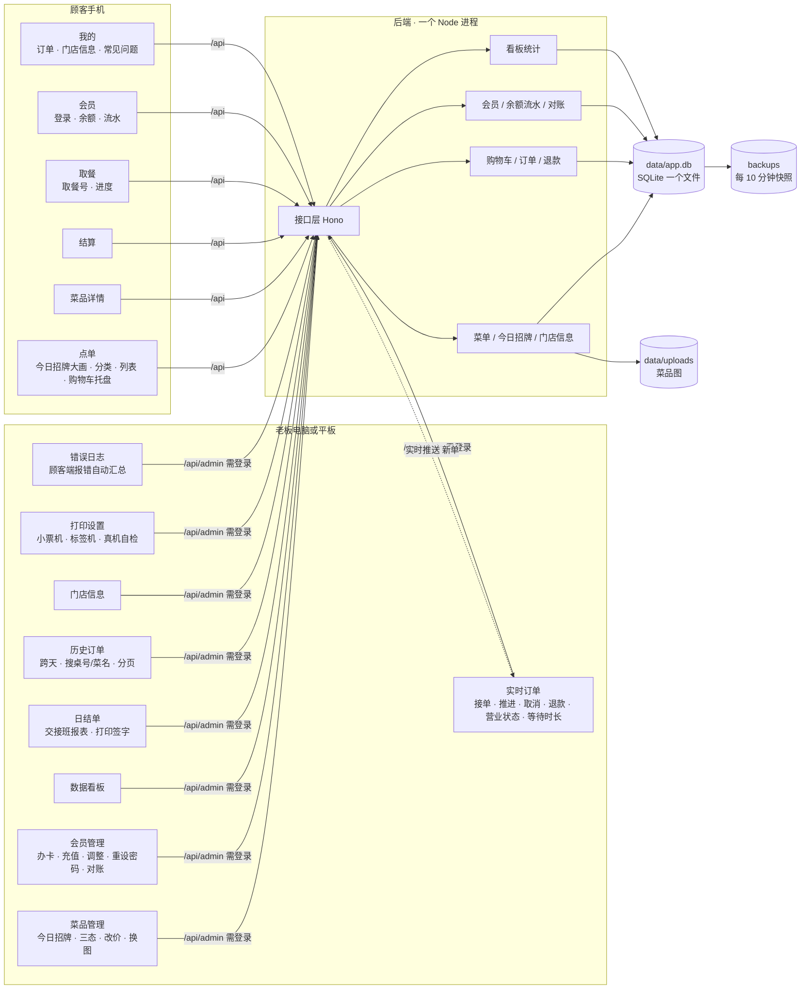

# 系统架构一页纸

> 2026-10-18，对应 main 标签 `p5-closeout`。一套代码换一份「店铺配置」（`brands/<店>/`）就能给另一家店用；代码里不许出现店名和散写的颜色（`npm run check` 会拦）。

## 模块图

## 代码目录

| 目录 | 是什么 |
|---|---|
| `apps/customer` | 顾客端（React 18 + Vite 7）。四个页签 点单 / 取餐 / 会员 / 我的，加详情和结算两页。`cart-plan.ts` 单独放「菜单页 + 按下去该发什么请求」的纯函数（R11 之后抽出来的，有单测），`orders.ts` 放加菜子单收回父单的规则 |
| `apps/admin` | 老板端（React 18 + Vite 7） |
| `apps/server` | 后端（Hono + better-sqlite3）。`migrations/` 12 个迁移文件（001–012），只增不改。**新加迁移后必须重启一次 dev server**，迁移只在进程启动时跑 |
| `packages/contract` | 前后端共用的数据格式（zod），接口长什么样以这里为准 |
| `packages/ui-kit` | 公共零件 + 品牌注入（颜色 token、字体、水墨纹理在构建时从 `brands/` 读进来） |
| `brands/xiangcun` | 店铺配置：店名、菜单、问答、颜色 token、自托管字体、水墨纹理 |
| `scripts` | 菜单导入、数据校验、产品化 / 色彩检查、字体裁剪、图片压缩、备份、演示版导出 |
| `e2e` | 真浏览器端到端测试（独立测试数据库），同时产出验收截图 |
| `deploy` | Litestream 实时备份模板（等服务器） |

## 接口清单

**顾客端（不用登录）**

| 接口 | 用途 |
|---|---|
| `GET /api/health` | 健康检查 |
| `GET /api/brand` · `/api/menu` · `/api/faq` | 店铺配置、菜单（含售罄 / 下架后的现状）、常见问题 |
| `GET /api/store/status` · `/api/store/today` · `/api/store/info` | 营业状态、今日招牌（菜品编号列表）、门店信息（58号新增） |
| `POST /api/cart/refresh` · `update` · `line` · `remove` · `clearItem` · `clear` · `buyAgain` | 购物车（以服务器为准，价格永远按当前菜单现算）。`line` / `remove` 按行 id 改辣度、备注、删行，同一道菜不同辣度各占一行 |
| `GET /api/cart/waitingTime` | 当前等待时长 |
| `POST /api/order/submit` · `POST /api/order/add` · `GET /api/order/mine` · `GET /api/order/:id` | 下单、加菜、我的订单、单张订单 |
| `POST /api/member/login` · `logout` · `GET /api/member/me` | 会员登录（4 位密码，错多次锁定）、余额与流水（只读） |
| `POST /api/client-error` | 前端报错上报（不鉴权、按 IP 限流、同一错误只累加次数） |
| `GET /media/:file` | 老板上传的菜品图 |

**老板端（先 `POST /api/admin/login`，之后都带令牌）**

| 接口 | 用途 |
|---|---|
| `GET /api/admin/orders` · `POST …/orders/:id/status` · `…/refund` | 订单列表、推进 / 取消、按行退款 |
| `GET /api/admin/counter-refunds` · `POST …/:id/resolve` | 待柜台退还 |
| `GET/POST /api/admin/wait` · `POST /api/admin/store` | 等待时长设置、暂停接单 / 营业时间 |
| `GET /api/admin/dishes` · `POST …/:uid/state` · `price` · `image` · `image/clear` | 菜品三态、改价、上传 / 删除图片（都留改动记录） |
| `GET/POST /api/admin/today` | 今日招牌（54号） |
| `GET/POST /api/admin/store-info` | 门店信息（58号） |
| `GET/POST /api/admin/members` · `GET …/:id` · `POST …/recharge` · `adjust` · `pin` | 会员办卡、查询、充值、调整、重设密码 |
| `GET/POST /api/admin/reconcile` | 对账（每天自动一次，也可手动） |
| `GET /api/admin/dashboard` | 数据看板 |
| `GET /api/admin/stream/ticket` → `GET /api/admin/stream?ticket=` | 实时推送新单（SSE，25 秒心跳）。先把令牌换成 30 秒一次性票据再连，避免令牌出现在网址和日志里 |
| `GET /api/admin/client-errors` · `POST …/clear` | 前端报错汇总（顾客端 / 老板端分开显示）、清空 |

## 加菜：一张桌的单在库里其实是两张（P2-6）

客人吃到一半加两瓶柠檬茶，**不会改动原单**，而是另开一张子单挂在它下面。

| | 父单 | 子单 |
|---|---|---|
| 关系 | `parent_order_id IS NULL` | `parent_order_id` 指向父单，`add_seq` = 第几次加菜（1、2、3…） |
| 金额 | 下单那一刻的价，永不改 | 加菜那一刻的价，独立一张单 |
| 付款 / 退款 | 自己一套 | 自己一套（每一笔钱都算得清、退得掉） |
| 取餐号 | 真实号 | 库里有占位号（当天最大 + 1），**接口一律换成父单号**，外面看不到 |
| 合计 | `groupTotalSen` = 自己 + 所有子单 | 同上（回到父单算，两个视角的数字必须一样） |

**为什么另开一张而不是往原单里加行**：`total_sen` 在系统里是「下单那一刻的价」，退款按行退、账本只增不删、`order_items` 的触发器禁止 UPDATE/DELETE（已经下给后厨的菜不能被悄悄改掉）。往原单里追加行就要重新定义「这张单当时是多少钱」，日结单、看板、退款分摊比例全部得推倒重来。子单方案下这些口径一个都不用改。

**代码里要注意的三处**：

- 顾客端两个订单列表都要过 `rollUpAdditions()`（`apps/customer/src/orders.ts`）：接口按 `created_at` 倒序给单，子单永远排在父单前面，直接取第一条会拿到子单——号是对的但 `addCount` / `groupTotalSen` 只算在父单上，页面会显示成「没加过菜、钱还少了」
- `addDishes()` 的 `requestId` 幂等检查**必须在所有业务校验之前**：重试时购物车已被第一次成功清空，先查「购物车空不空」会误报「购物车是空的」
- 老板端订单台上，父子单各自是一张卡，子单标「加菜 +1」，两张卡都写「这一桌一共 X（这张单 Y）」——收款要按整桌收

迁移：`012_order_add_dishes.sql`。

## 技术栈

Node.js 22+ · TypeScript 5.8 · React 18 · Vite 7.3 · Hono 4 · SQLite（better-sqlite3）· zod 3 · Vitest 4.1 · Playwright。字体全部自托管裁剪（马善政书法、Cinzel 英文、霞鹜文楷正文），不依赖外部字体服务。依赖版本锁在 `package-lock.json`，部署用 `npm ci`。

## 质量护栏（`npm run check`，一条命令全跑）

1. `check:audit`：依赖安全审计，中危及以上直接不过（58号新增）
2. `check:brand`：代码里没有店名、没有散写颜色、时间全部走门店时区
3. `check:palette`：颜色 token 色相审计，不许新增绿 / 蓝 / 粉（56号）
4. `check:data`：菜单、问答、付款方式、字体覆盖校验
5. `typecheck` + 单元测试

端到端测试：`npm run e2e`（真起三个服务、独立测试库）。

## 已知限制

| 限制 | 说明 |
|---|---|
| **还没上生产** | 服务器、域名、对象存储未定；见《部署与回滚手册》第一章 |
| **会员体系新功能未上线** | 58号挂起：等级 / 成长值 / 权益（57号）不实现；会员卡黑金四档色板已做在 56号里，按「前端暂时先这样」保持现状 |
| **前端冻结** | 视觉不再改，未决的前端项见 `前端冻结清单.md` |
| 没有库存数量 | 只有在售 / 今日售罄 / 下架三态，不记份数 |
| 没有在线支付 | 付款方式只是记账（现金、电子钱包到柜台，储值在系统内扣） |
| 会员导入未做 | 等老系统的会员数据导出样例 |
| 老板端只有一个密码 | 没有分店员账号；所有操作记为「admin」 |
| 菜品实拍图 | 104 道菜目前全部是书法字占位，等实拍图上传 |
| 演示版 | 菜单是导出时的快照；会员登录不模拟 |
| 前端只有零星单测 | 服务端 200+ 用例，前端这几年只覆盖了纯逻辑（金额、日期、滚牌、缩略字、加法单收回、购物车决策）。页面交互靠 Playwright 手动巡逻，没有进 CI 的 e2e 用例（`npm run e2e` 要真起三个服务）。R11（顾客点「+」无反应）就是这么漏掉的 |
