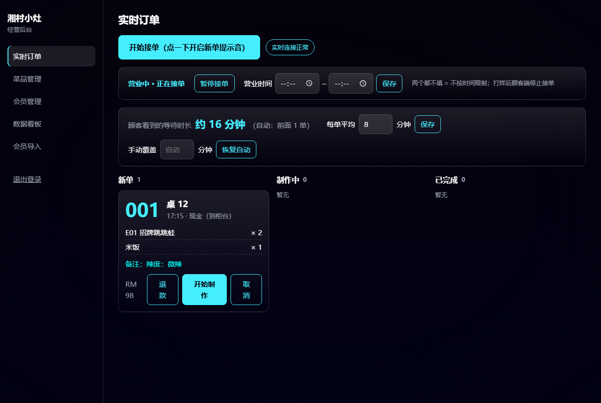
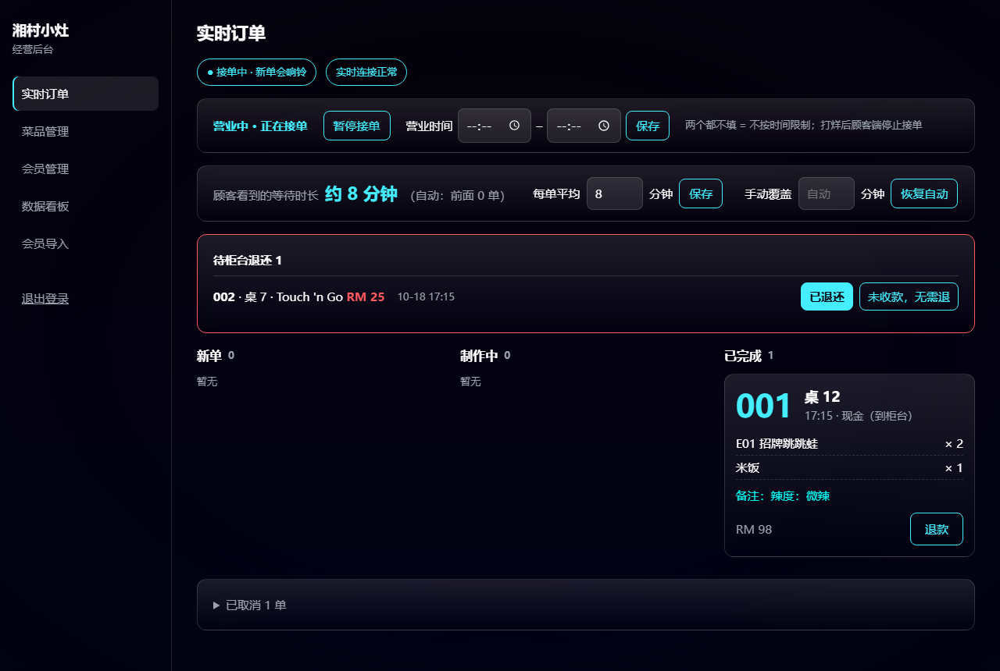
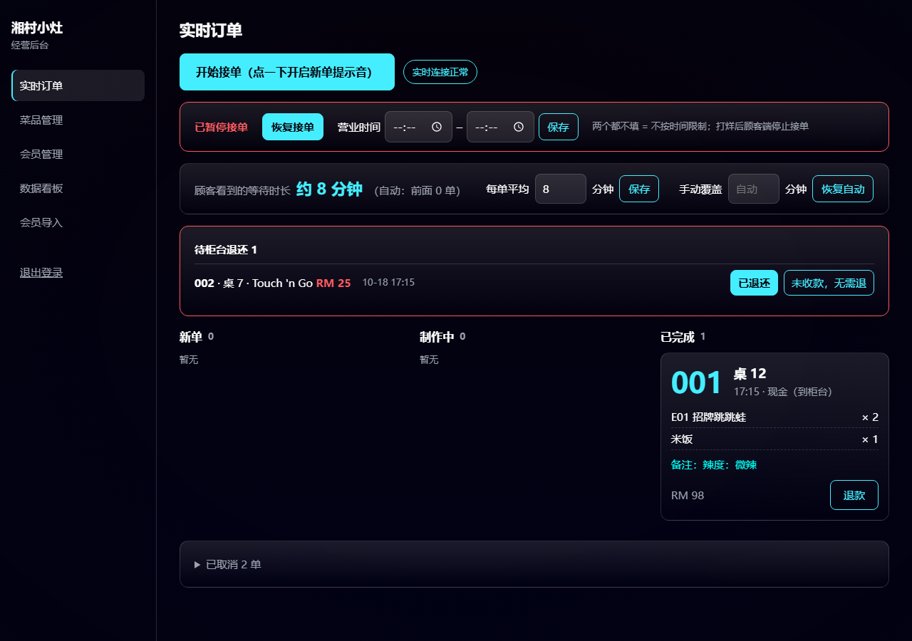
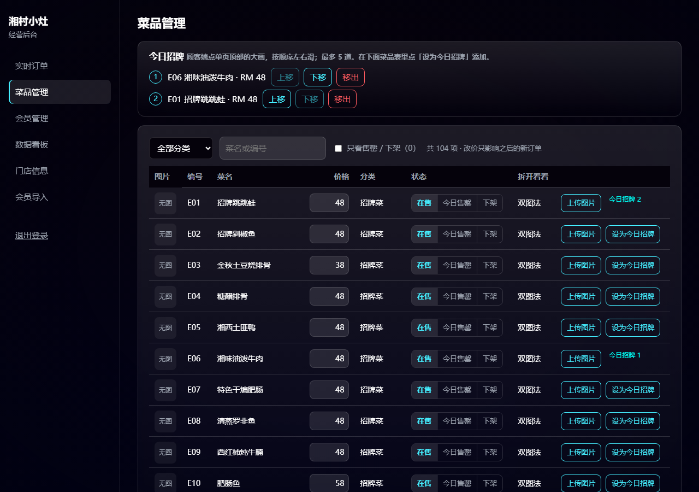
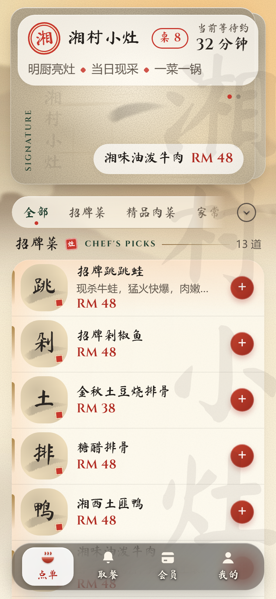
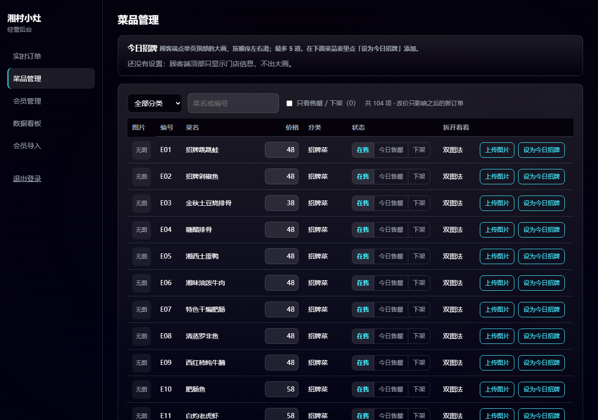
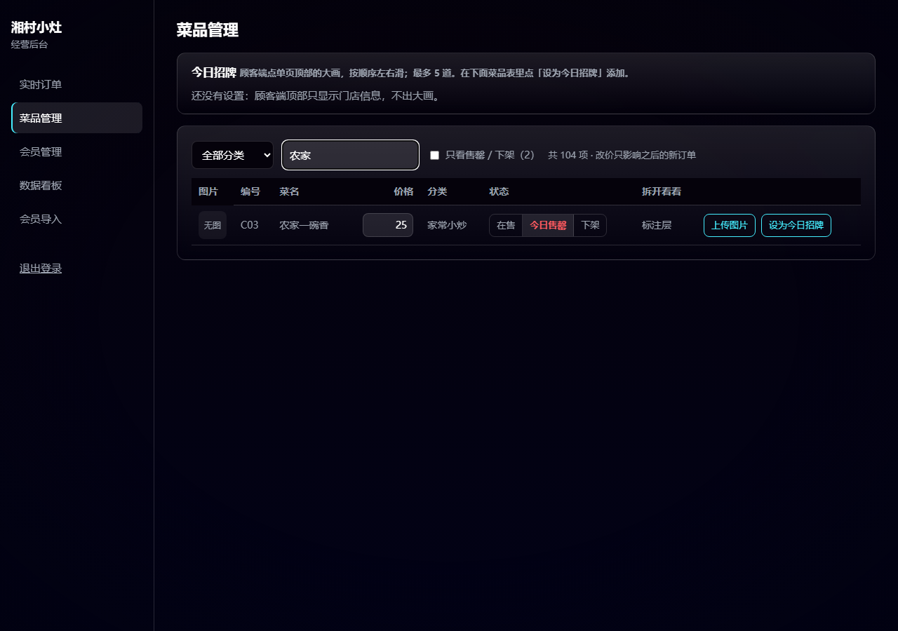
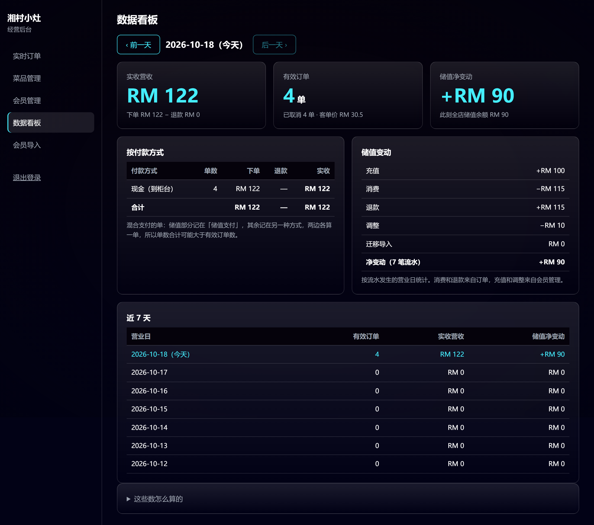
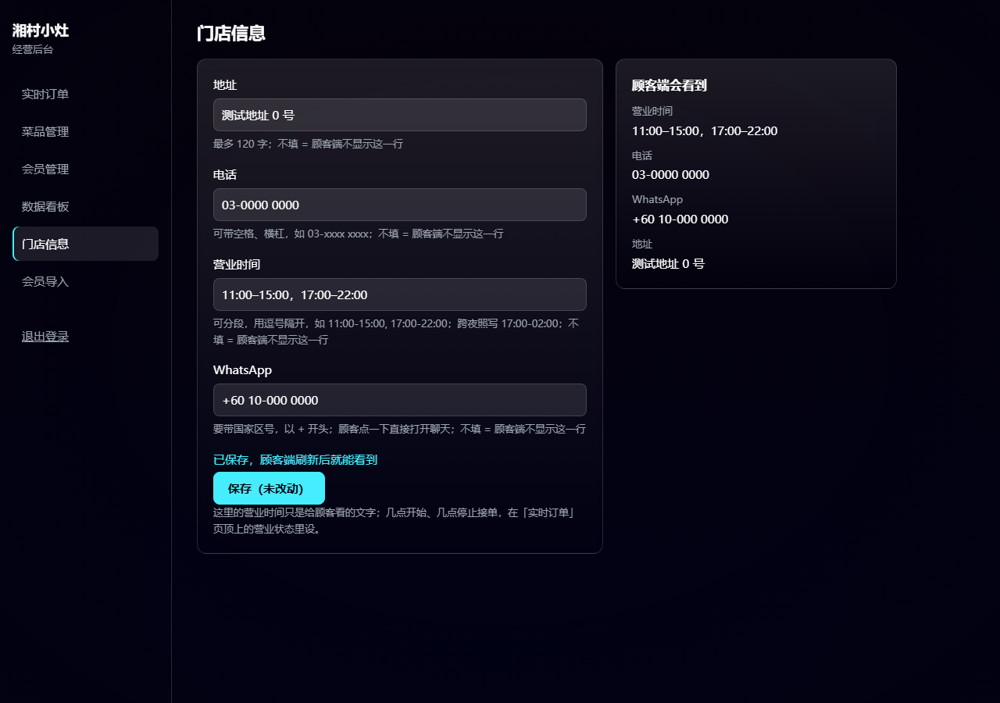
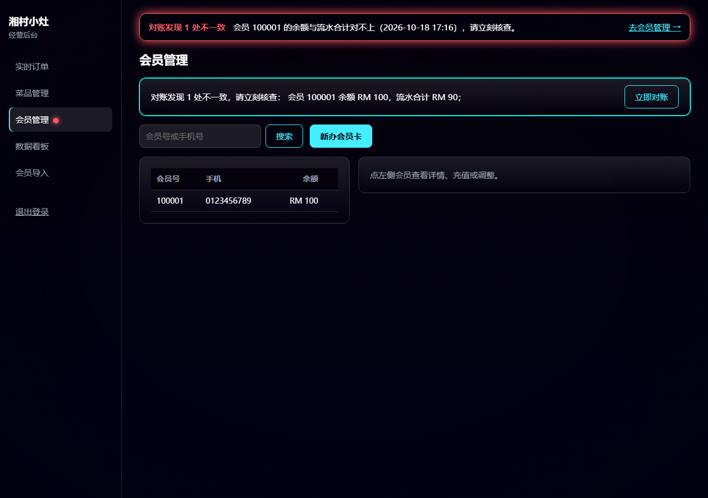

# 老板使用手册

> 写给老板：不用懂技术，照着做就行。老板端用电脑或平板的浏览器打开（地址等服务器定了再填在这里：`______`）。
> 左边一列是六个页面：实时订单、菜品管理、会员管理、数据看板、门店信息、会员导入（会员导入还没做，等老系统的会员数据导出来）。

---

## 一、每天开门要做的三件事

1. **登录**：输入老板密码。密码输错几次会锁定一会儿（防别人乱猜），提示里会写还要等几分钟。
2. **点「开始接单」**：在「实时订单」页最上面。这一下是为了打开提示音——浏览器规定，网页要先被点一下才能出声。点完显示「● 接单中 · 新单会响铃」。
3. **看右上角是不是「实时连接正常」**：如果变成「连接中断，正在自动重连…」，说明网断了，可能漏单。网恢复后会自动把断网期间的单补上。

---

## 二、接单和出餐（「实时订单」页）

- 新单出现在左边「新单」列，会响铃、闪一下。单子上有取餐号、桌号、下单时间、付款方式、菜和份数、顾客备注（辣度也写在备注里）。
- 开始做就点「**开始制作**」，做好点「**完成**」。顾客手机上的取餐页会跟着变。
- **取消**：点「取消」，必须选或写一个原因（客人取消 / 菜品售罄 / 重复下单 / 自己写）。用了储值的部分会自动退回会员余额；现金、电子钱包这类会进「待柜台退还」，在柜台退完钱后去那里点一下标记。
- **退一部分菜**：点「退款」，按菜品行选退几份、写原因。全部菜都退完、还没做完的单，系统会自动取消，并标「系统自动取消」，和人工取消分得开。

### 营业状态和等待时长（同一页上方）

- **暂停接单**：忙不过来时点它，顾客端立刻显示「本店暂停接单」，不能下单；点「恢复接单」恢复。
- **营业时间**：填开门和打烊时间（支持跨夜，比如 17:00–02:00），打烊后顾客端自动停止接单。两个都不填 = 不按时间限制。
- **顾客看到的等待时长**：系统按「前面有几单 × 每单平均几分钟」自动算；可以改「每单平均」的分钟数，忙的时候也可以「手动覆盖」一个数，忙完点「恢复自动」。

---

## 三、今日招牌怎么配（「菜品管理」页最上面）

顾客打开点单页，最上面是一张大画，可以左右滑——这里放哪几道菜，由你决定。

1. 进「菜品管理」，在下面的菜品表里找到想放的菜，点这一行最右边的「**设为今日招牌**」。
2. 最多放 5 道。上面「今日招牌」框里能调顺序（上移 / 下移），第一道就是顾客最先看到的那张。
3. 不想要了点「移出」。一道都不放时，顾客端顶部只显示门店框，不出大画。
4. 招牌只记「是哪道菜」，菜名、价格、图片都跟着菜品走：你改了价、换了图，大画上自动跟着变。下架的菜不会出现在顾客端。

配好后顾客端顶部的样子：

---

## 四、菜品管理（同一页下面的表）

| 想做的事 | 怎么做 |
|---|---|
| 今天卖完了 | 这道菜点「**今日售罄**」。顾客端显示售罄、不能再加；**第二天自动恢复在售**，不用记着改回来 |
| 长期不卖了 | 点「**下架**」。顾客端看不到；想卖了再点「在售」 |
| 改价格 | 直接改价格框里的数字。**只影响之后的新单**，已经下的单还按原价 |
| 换菜品图 | 点「上传图片」选照片。太大的照片会自动压缩到 300KB 以内；只支持 JPG、PNG、WebP |
| 删掉上传的图 | 点「删除图片」，恢复成书法字占位。原图不会真删，改动记录里能找回 |
| 找某道菜 | 上面可以按分类筛、按菜名或编号搜；勾「只看售罄 / 下架」能一眼看到今天哪些菜不能点 |

每一次上下架、改价、换图都会留记录（谁、什么时候、从什么改成什么）。

### 关于「库存预警」

**系统现在没有库存数量功能**（不记还剩几斤几份，也不会自动提醒快没了）。目前的做法是：备料用完了，就把那道菜点成「今日售罄」——顾客马上看不到可点，第二天自动恢复。勾「只看售罄 / 下架」就是当天的「缺货清单」。如果以后需要按份数自动售罄，要另开一批来做。

---

## 五、销售数据怎么读（「数据看板」页）

最上面三个大数字，都是**当天**的：

| 数字 | 意思 |
|---|---|
| **实收营收** | 今天收到的钱 = 下单金额 − 退款。下面一行小字写了这两个数 |
| **有效订单** | 今天没被取消的单数；小字里有已取消几单、客单价（平均每单多少钱） |
| **储值净变动** | 今天会员储值一共多了还是少了（充值是加，用储值买单是减）；小字是「此刻全店储值余额」，也就是所有会员卡里现在一共还有多少钱 |

下面两张表：

- **按付款方式**：现金、电子钱包、储值各收了多少。一单用「储值 + 现金」合付时，两边各算一单，所以这里的单数加起来可能比有效订单多——这是正常的。
- **储值变动**：充值、消费、退款、调整各多少。

最下面「**近 7 天**」：每天的单数、营收、储值变化，点哪一天就看哪一天。顶上「‹ 前一天」「后一天 ›」也能翻。

「营业日」按吉隆坡时间的日历日算，取餐号每天从 001 开始，和这里是同一条线。看板最下面「这些数怎么算的」可以展开看完整规则。

---

## 六、门店信息（「门店信息」页）

顾客端「我的」页有一张门店小卡，内容就从这里来。

- 四项：**地址、电话、营业时间、WhatsApp**。
- 营业时间可以分段，用逗号隔开，比如 `11:00-15:00, 17:00-22:00`；跨夜照写 `17:00-02:00`。写不对会当场提示。
- WhatsApp 要带国家区号、以 + 开头。顾客点一下电话会直接拨号，点 WhatsApp 会直接打开聊天。
- **哪一项不填，顾客端就不显示那一行**；四项都不填，门店小卡整张不显示。不会再出现「待提供」。
- 右边「顾客端会看到」是预览，保存前就能看到效果。
- 注意：这里的营业时间**只是给顾客看的文字**；几点开始、几点停止接单，在「实时订单」页的营业状态里设。

---

## 七、会员管理（现状版）

> 会员体系的新功能（等级、成长值、权益）按 58号挂起，没有做。下面是现在就能用的功能。

- **办卡**：填手机号（可不填）和顾客自己设的 4 位密码（输两遍），点「办卡」。会员号系统自动编，办好告诉顾客。
- **充值 / 调整**：搜会员号或手机号，打开这位会员操作。每一笔都记流水，不能删。
- **重设密码**：顾客忘了密码时用。系统里存的是加密后的密码，**谁也查不到原来的密码**，只能重设。
- **对账**：系统每天自动核对「每位会员的余额 = 他所有流水的合计」。对不上时，老板端每一页顶部都会出现红色横幅，「开始接单」旁边亮红点——这时先别充值，按横幅里的会员号去核对。也可以随时点「立即对账」。
- 流水可以打印。

---

## 八、遇到问题

| 情况 | 怎么办 |
|---|---|
| 一直「连接中断」 | 先看店里网络；网好了还不恢复，刷新页面；还不行联系技术 |
| 顾客说下不了单 | 看是不是点了「暂停接单」或过了营业时间；都不是就联系技术 |
| 顶部红色对账横幅 | 停止充值，联系技术一起核对；不要自己想办法改余额 |
| 忘了老板密码 | 联系有服务器权限的人改（见《部署与回滚手册》） |
